# 🤖 RepoReview AI

### Multi-Agent AI-Powered GitHub Repository Code Review System

**RepoReview AI** is an AI-powered multi-agent code review system that analyzes GitHub repositories and generates a structured engineering review covering **repository architecture, code quality, security, bugs, maintainability, and actionable recommendations**.

The system uses **Pydantic AI** to orchestrate specialized AI agents backed by **Google Gemini**, with **Pydantic models** enforcing structured communication between agents.

Instead of asking a single LLM to review an entire repository, RepoReview AI divides the task into specialized responsibilities and then uses a senior-review agent to synthesize the results.

---

## ✨ What RepoReview AI Does

Given a public GitHub repository URL, RepoReview AI:

```text
GitHub Repository
       │
       ▼
Clone Repository
       │
       ▼
Repository Analysis
       │
       ├───────────────┐
       ▼               ▼
Code Quality       Security &
Review             Bug Review
       │               │
       └───────┬───────┘
               ▼
       Senior Review
               │
        ┌──────┴──────┐
        ▼             ▼
   Streamlit UI   Markdown Report
```

The final result provides:

* Repository overview
* Architecture analysis
* Important files
* Frameworks and technologies
* Code-quality findings
* Security findings
* Bug findings
* Severity classification
* File and line references where identifiable
* Repository strengths
* Actionable engineering recommendations

---

# 🎯 Motivation

Traditional code-review tools generally focus on predefined static-analysis rules.

LLM-based code review can provide deeper contextual reasoning, but asking a single agent to understand an entire repository can lead to:

* incomplete analysis
* hallucinated findings
* duplicated observations
* inconsistent severity
* poor architectural understanding
* unstructured output

RepoReview AI addresses this by using a **specialized multi-agent architecture**.

Each agent has a clearly defined responsibility:

| Agent         | Responsibility                        |
| ------------- | ------------------------------------- |
| 🔎 Agent 1    | Repository architecture and structure |
| 🧹 Agent 2    | Code quality and maintainability      |
| 🛡️ Agent 3   | Security and obvious bugs             |
| 👨‍💻 Agent 4 | Senior-level validation and synthesis |

The final agent does not blindly trust the other agents. It reviews their structured outputs, removes duplicates and unsupported findings, and produces the final review.

---

# 🏗️ System Architecture

## High-Level Architecture

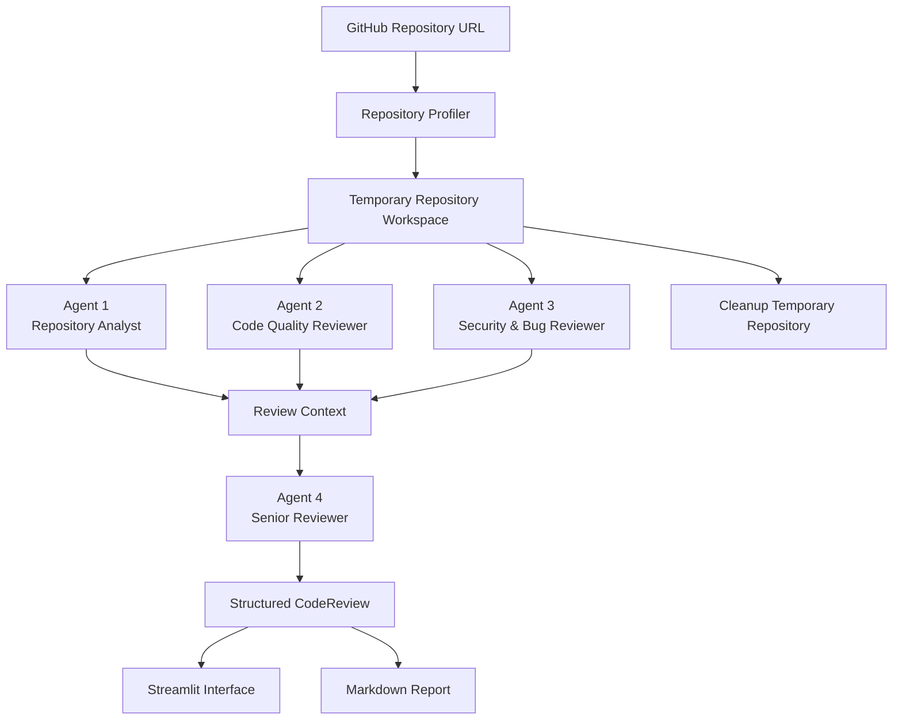

---

# 🤖 Multi-Agent Architecture

## Agent 1 — Repository Analyst

**Purpose:** Understand what the repository is and how it is structured.

Agent 1 investigates the actual repository rather than relying only on filenames.

### Responsibilities

* Identify the primary programming language
* Identify frameworks and major libraries
* Find important files
* Identify application entry points
* Understand architecture
* Identify component relationships
* Identify data flow
* Inspect configuration
* Inspect testing structure
* Identify infrastructure/deployment components
* Identify genuine repository strengths

### Example Output

```text
Primary Language:
Python

Frameworks:
Django

Infrastructure:
Terraform
Ansible

Architecture:
Django web application with recommendation
logic separated into helper modules and
ML model artifacts loaded by the backend.
```

---

# 🧹 Agent 2 — Code Quality Reviewer

**Purpose:** Analyze maintainability, architecture, performance, and engineering quality.

### Review Areas

* Code organization
* Separation of concerns
* Naming
* Duplication
* Function complexity
* Class complexity
* Error handling
* Maintainability
* Testing
* Resource management
* Performance
* API design
* Database usage
* Dependency usage
* Architectural coupling

### Finding Structure

Every accepted finding follows a structured schema:

```python
class CodeQualityFinding(BaseModel):
    title: str
    description: str
    severity: Severity
    file: str | None = None
    line: int | None = None
    recommendation: str
```

This prevents the agent from returning arbitrary unstructured review text.

---

# 🛡️ Agent 3 — Security & Bug Reviewer

**Purpose:** Identify security vulnerabilities and obvious runtime or logic problems.

### Security Areas

The agent investigates relevant areas including:

* Hardcoded secrets
* API keys
* Credentials
* Authentication
* Authorization
* Access control
* SQL injection
* Command injection
* Code injection
* Path traversal
* Unsafe file operations
* Unsafe subprocess usage
* Unsafe deserialization
* Sensitive information exposure
* Insecure configuration
* Cryptographic practices
* Dependency concerns

### Bug Analysis

The agent also looks for obvious:

* Runtime errors
* Incorrect conditions
* Incorrect return behavior
* State-management problems
* Database operation mistakes
* Resource-handling problems
* Logic errors

### False-Positive Control

A major design goal is to prevent generic security advice from becoming a vulnerability finding.

For example:

```text
❌ "The application should use environment variables."

```

is not automatically considered a vulnerability.

But:

```text
⚠️ A production secret is hardcoded in configuration
and is used as the application's secret key.
```

can become a concrete finding when supported by the inspected code.

---

# 👨‍💻 Agent 4 — Senior Reviewer

The Senior Reviewer is responsible for **final synthesis**.

It receives the structured outputs from Agents 1–3.

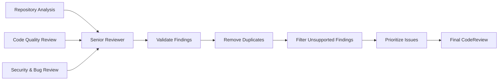

### Senior Review Responsibilities

The Senior Reviewer:

1. Validates specialist findings
2. Removes duplicate findings
3. Removes unsupported/speculative findings
4. Resolves contradictions
5. Preserves legitimate findings
6. Separates quality and security findings
7. Identifies repository strengths
8. Prioritizes important issues
9. Generates actionable recommendations

### Recommendation Priority

Recommendations are prioritized approximately around:

```text
Security Risks
      ↓
Critical / High Bugs
      ↓
Performance Problems
      ↓
Maintainability
      ↓
Testing
      ↓
Lower-Priority Improvements
```

Recommendations are derived from accepted findings rather than generated independently from the repository.

---

# 🔄 Agent Collaboration

The agents communicate through **typed Pydantic models**.

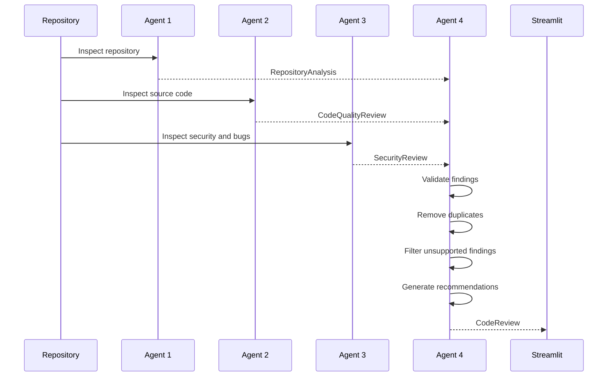

This gives the project a clear distinction between:

**specialist analysis → validation → synthesis**

rather than simply running four unrelated LLM calls.

---

# 🧠 Structured AI Outputs

Pydantic models provide a contract between agents.

The main models include:

```text
RepositoryAnalysis
        │
        ├── repository
        ├── summary
        ├── primary_language
        ├── frameworks
        ├── key_files
        ├── architecture_notes
        └── strengths


CodeQualityReview
        │
        ├── summary
        └── findings[]
              ├── title
              ├── description
              ├── severity
              ├── file
              ├── line
              └── recommendation


SecurityReview
        │
        ├── summary
        └── findings[]


CodeReview
        │
        ├── repository
        ├── summary
        ├── strengths
        ├── quality_findings
        ├── security_findings
        └── recommendations
```

This is one of the central design decisions of the project.

---

# 🛠️ Repository Tooling

RepoReview AI provides agents with repository inspection tools.

## Repository Cloning

Repositories are cloned into temporary directories using a shallow clone:

```bash
git clone --depth 1 <repository-url>
```

This reduces unnecessary Git history and download size.

---

## Repository Structure Inspection

The repository profiler recursively analyzes the cloned repository while ignoring directories that are generally irrelevant to source analysis.

Ignored directories include:

```text
.git
.venv
venv
__pycache__
node_modules
dist
build
.pytest_cache
```

---

## Safe File Reading

The repository tool validates requested paths before reading files.

Conceptually:

```text
Requested File
      │
      ▼
Resolve Absolute Path
      │
      ▼
Is Path Inside Repository?
      │
   ┌──┴──┐
   │     │
  Yes    No
   │     │
   ▼     ▼
 Read   Reject
 File   Request
```

This prevents repository-tool path traversal outside the temporary workspace.

---

# 🧩 Technology Stack

| Technology        | Role                         |
| ----------------- | ---------------------------- |
| **Python**        | Core application             |
| **Pydantic AI**   | AI agent orchestration       |
| **Pydantic**      | Structured output validation |
| **Google Gemini** | LLM provider                 |
| **Streamlit**     | Web interface                |
| **Git**           | Repository cloning           |
| **pytest**        | Automated testing            |
| **Docker**        | Containerization             |
| **python-dotenv** | Environment management       |

---

# 📁 Project Structure

```text
RepoReview/
│
├── app/
│   ├── __init__.py
│   │
│   ├── agent.py
│   │   └── Repository Analyst
│   │
│   ├── quality_agent.py
│   │   └── Code Quality Reviewer
│   │
│   ├── security_agent.py
│   │   └── Security & Bug Reviewer
│   │
│   ├── senior_agent.py
│   │   └── Senior Review Synthesizer
│   │
│   ├── pipeline.py
│   │   └── Multi-agent orchestration
│   │
│   ├── models.py
│   │   └── Pydantic schemas
│   │
│   ├── config.py
│   │   └── Environment configuration
│   │
│   ├── report.py
│   │   └── Markdown report generation
│   │
│   └── tools/
│       ├── __init__.py
│       └── repository.py
│           ├── Repository cloning
│           ├── Structure inspection
│           └── Safe file reading
│
├── frontend/
│   └── streamlit_app.py
│       └── Streamlit user interface
│
├── tests/
│   ├── __init__.py
│   └── test_repository.py
│
├── reports/
│   └── .gitkeep
│
├── images/
│   ├── streamlit.png
│   ├── repository-analysis.png
│   ├── code-quality.png
│   ├── security-review.png
│   └── recommendations.png
│
├── main.py
├── Dockerfile
├── .dockerignore
├── .env.example
├── .gitignore
├── requirements.txt
└── README.md
```

---

# 💻 User Interface

RepoReview AI provides a Streamlit interface divided into four review sections.

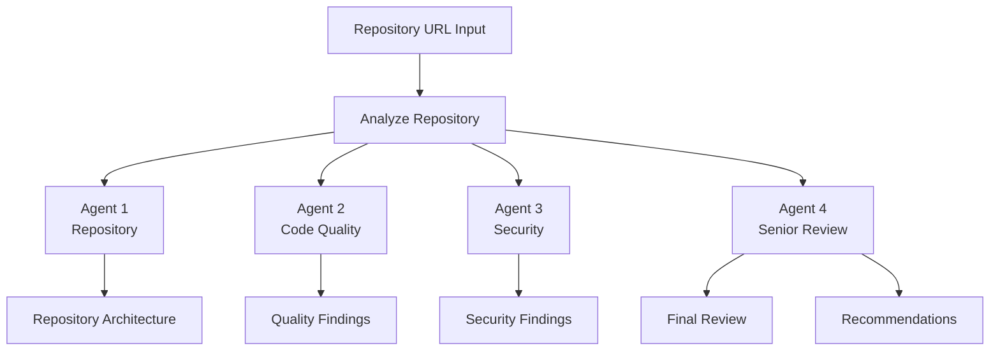
## 📸 Screenshots

### 🖥️ Main Interface

<p align="center">
  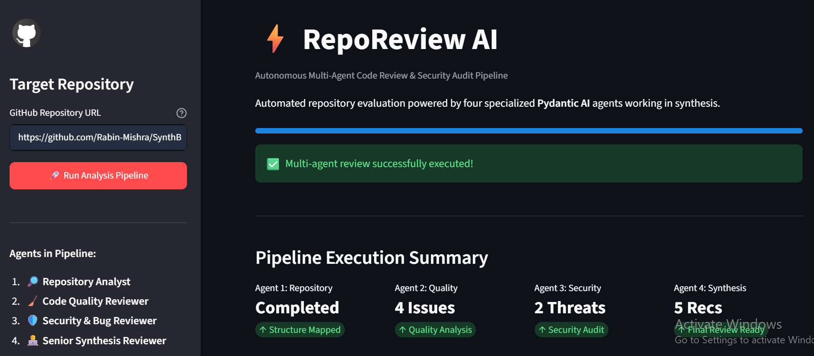
</p>

---

### 🔎 Repository Analysis

<table>
  <tr>
    <td width="50%">
      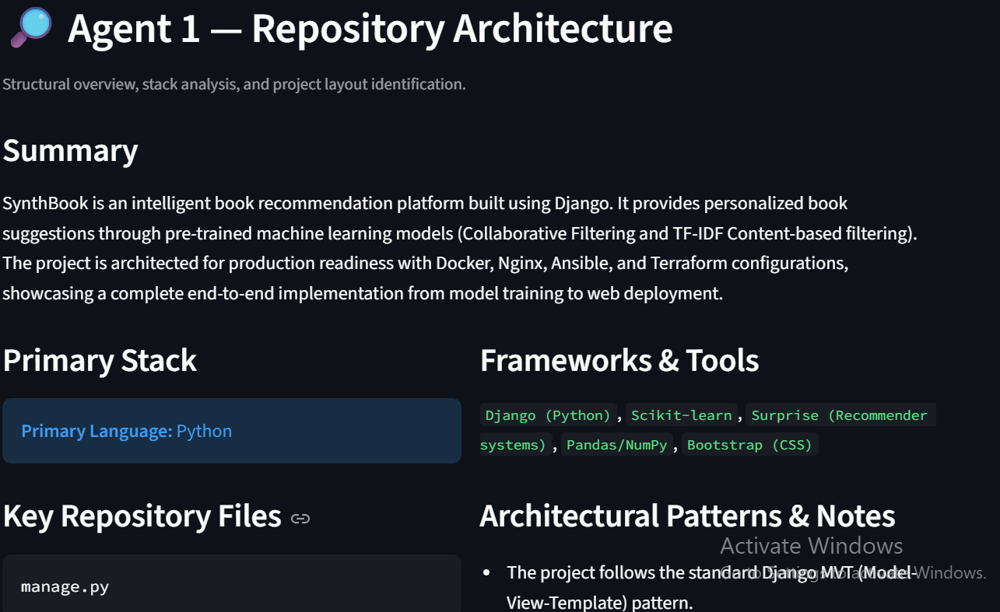
    </td>
    <td width="50%">
      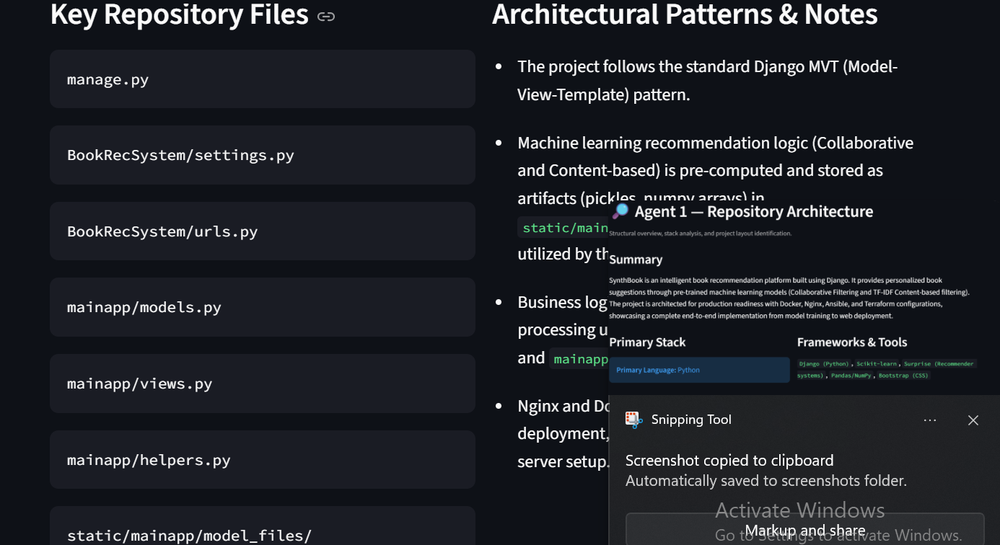
    </td>
  </tr>
  <tr>
    <td colspan="2" align="center">
      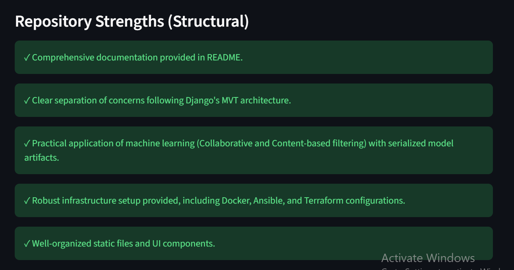
    </td>
  </tr>
</table>

---

### 🧹 Code Quality Review

<table>
  <tr>
    <td width="50%">
      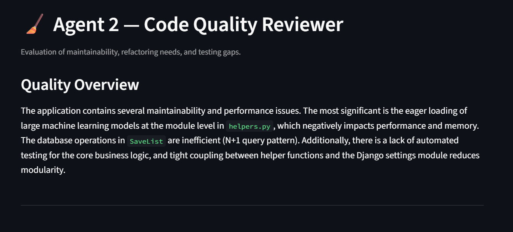
    </td>
    <td width="50%">
      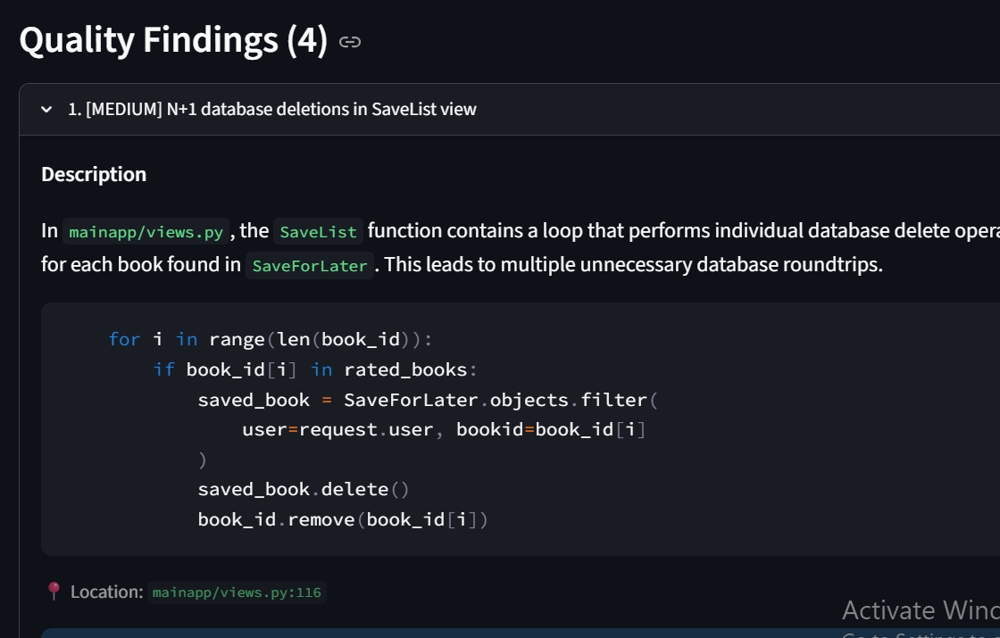
    </td>
  </tr>
  <tr>
    <td colspan="2" align="center">
      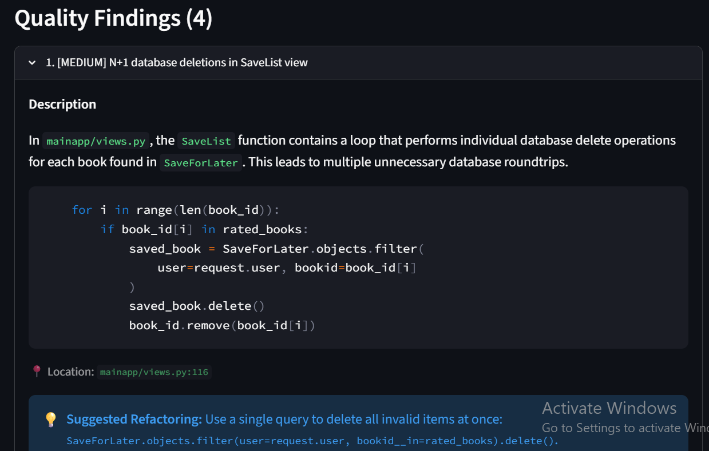
    </td>
  </tr>
</table>

---

### 🛡️ Security Review

<table>
  <tr>
    <td width="50%">
      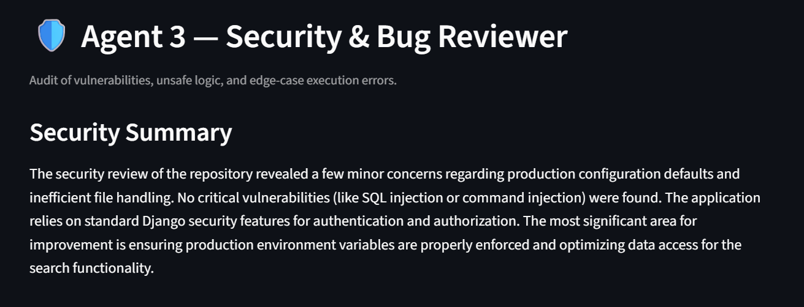
    </td>
    <td width="50%">
      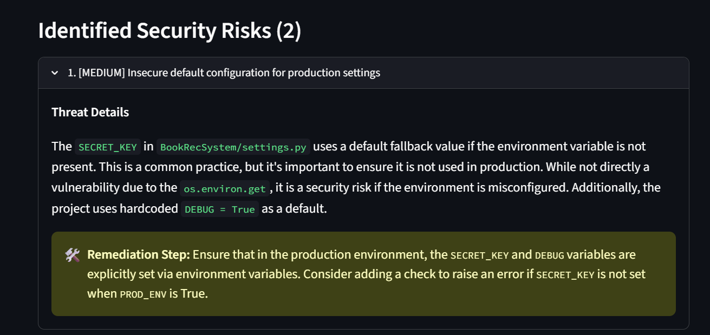
    </td>
  </tr>
  <tr>
    <td colspan="2" align="center">
      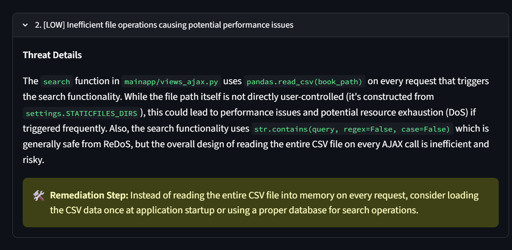
    </td>
  </tr>
</table>

---

### 👨‍💻 Final Senior Review

<table>
  <tr>
    <td width="50%">
      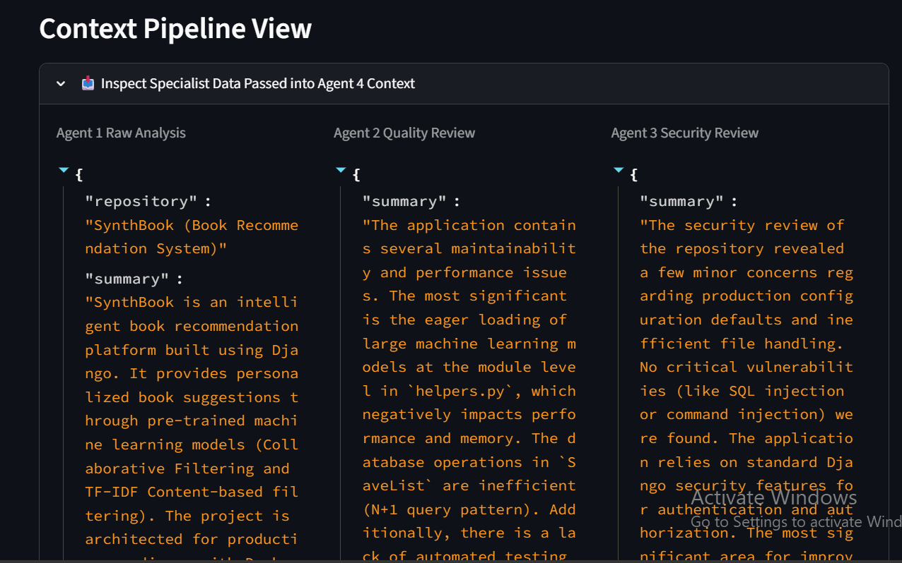
    </td>
    <td width="50%">
      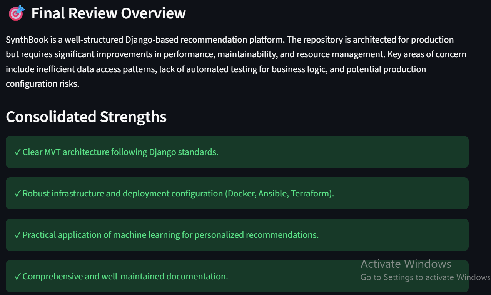
    </td>
  </tr>
  <tr>
    <td width="50%">
      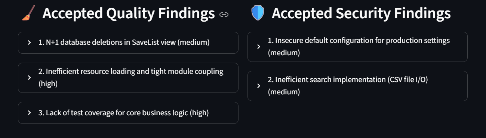
    </td>
    <td width="50%">
      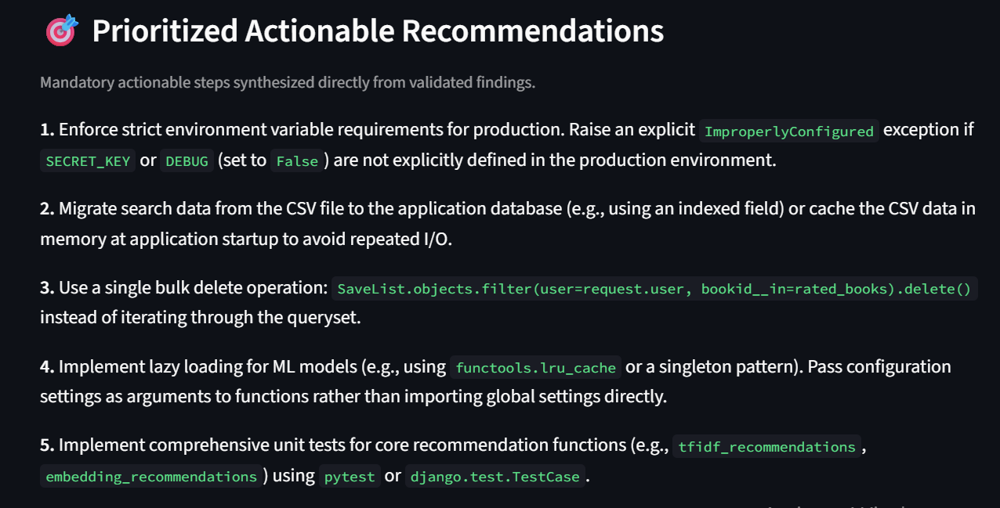
    </td>
  </tr>
</table>

```

# ⚙️ Installation

## 1. Clone the project

```bash
git clone https://github.com/arpanneupane75/RepoReview.git
cd RepoReview
```

> Replace the repository URL if your GitHub repository uses a different name.

---

## 2. Create a virtual environment

### Windows

```powershell
python -m venv .venv
.venv\Scripts\Activate.ps1
```

### Linux / macOS

```bash
python -m venv .venv
source .venv/bin/activate
```

---

## 3. Install dependencies

```bash
pip install -r requirements.txt
```

---

# 🔐 Environment Configuration

Create a `.env` file:

```env
GOOGLE_API_KEY=your_gemini_api_key
```

A safe template is included:

```text
.env.example
```

Example:

```env
GOOGLE_API_KEY=your_gemini_api_key_here
```

### Important

Never commit your actual API key.

The project `.gitignore` excludes:

```text
.env
```

---

# ▶️ Running Locally

Start the Streamlit application:

```bash
streamlit run frontend/streamlit_app.py
```

Then open:

```text
http://localhost:8501
```

Enter a public GitHub repository URL.

Example:

```text
https://github.com/username/project
```

Then click:

**Analyze Repository**

---

# 🐳 Docker

RepoReview AI includes a Docker configuration so the complete application can run inside a container.

## Build

```bash
docker build -t reporeview-ai .
```

## Run

```bash
docker run --rm \
  -p 8501:8501 \
  --env-file .env \
  reporeview-ai
```

On Windows PowerShell:

```powershell
docker run --rm -p 8501:8501 --env-file .env reporeview-ai
```

Open:

```text
http://localhost:8501
```

If port `8501` is already occupied:

```powershell
docker run --rm -p 8502:8501 --env-file .env reporeview-ai
```

Then open:

```text
http://localhost:8502
```

---

# 🐳 Docker Architecture

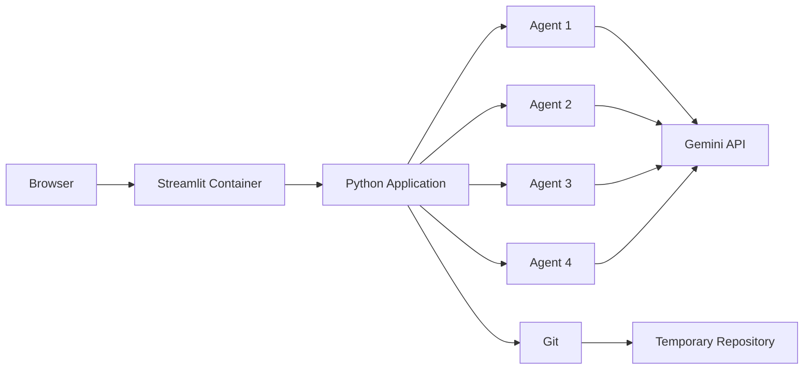

The Docker image includes Git because the application needs to clone repositories during analysis.

The Gemini API key is injected at runtime:

```bash
--env-file .env
```

The secret is therefore not baked into the Docker image.

---

# 🧪 Testing

Run:

```bash
pytest -v
```

The repository currently contains tests covering the repository tooling and report generation.

Current test coverage includes:

### Repository Structure

Verifies that repository files can be discovered correctly.

### Ignored Directories

Ensures directories such as `.git`, `__pycache__`, and virtual environments are excluded.

### File Reading

Tests reading files from the repository.

### Path Traversal Protection

Ensures files outside the repository cannot be accessed through manipulated paths.

### Missing Files

Ensures invalid file requests produce the appropriate error.

### Markdown Reports

Tests final Markdown report generation.

Example:

```text
6 passed
```

---

# 📝 Report Generation

The final structured review can be converted into a Markdown report.

The generated report contains sections such as:

```text
Repository Summary
        │
        ├── Strengths
        │
        ├── Code Quality Findings
        │
        ├── Security & Bug Findings
        │
        └── Recommendations
```

This allows the AI review to be used outside the Streamlit interface.

---

# 🔒 Security Design

Security is considered at multiple layers.

## API Key Protection

API credentials are loaded from environment variables.

```python
GOOGLE_API_KEY = get_required_env("GOOGLE_API_KEY")
```

The application fails early when the required environment variable is missing.

---

## Docker Secret Handling

`.env` is excluded from the Docker build context:

```text
.env
```

The key is injected when the container starts.

---

## Repository Isolation

Each repository is cloned into a temporary directory.

After the review:

```text
Review Complete
      │
      ▼
Temporary Directory
      │
      ▼
Deleted
```

This prevents temporary repository data from accumulating on the host.

---

## Path Validation

The repository tool resolves paths and ensures that requested files remain inside the cloned repository.

This protects the file-reading tool against directory traversal.

---

# ⚠️ Limitations

RepoReview AI is an AI-assisted review system and should not be considered a replacement for professional security auditing or deterministic static-analysis tools.

Current limitations include:

### Repository Size

Very large repositories may require additional context-management strategies.

### AI Accuracy

AI-generated findings may contain mistakes and should be validated by developers.

### Public Repositories

The current workflow is primarily designed around publicly accessible GitHub repositories.

### Dependency Security

The system does not independently claim CVEs without appropriate vulnerability-data verification.

### Context Selection

The quality of the review depends partly on which repository files the agents inspect.

### No Full CI Integration Yet

The current application is an interactive review tool rather than a complete CI/CD security gate.

---

# 🚀 Future Improvements

## GitHub Integration

* GitHub API integration
* Private repository support
* Pull request review
* Commit-based review
* Automated PR comments

## Large Repository Support

* Repository indexing
* Code embeddings
* Semantic file retrieval
* Context-aware file selection
* Incremental analysis

## Review Intelligence

* Review history
* Commit-to-commit comparison
* Finding persistence
* Regression detection
* Finding deduplication across reviews

## Developer Workflow

* GitHub Actions integration
* CI/CD integration
* Automatic Markdown reports
* PR review comments
* Human approval workflow

## Agent Architecture

* Parallel specialist execution
* Streaming agent progress
* More specialized reviewers
* Dependency-security agent
* Test-coverage agent
* Performance-analysis agent

---

# 📚 What I Learned Building This

This project was designed as a practical exploration of modern agentic AI development.

### Pydantic AI

* Agent creation
* Dependency injection
* Structured outputs
* Agent system prompts
* Multi-agent orchestration

### Pydantic

* Data validation
* Typed AI outputs
* Nested models
* Structured agent communication

### AI Engineering

* Prompt design
* Specialist agents
* Agent collaboration
* Finding validation
* Hallucination/false-positive reduction
* Structured synthesis

### Software Engineering

* Repository inspection
* Safe file handling
* Temporary workspace management
* Testing
* Configuration management
* Dockerization

### Application Development

* Streamlit
* Async Python
* Markdown report generation
* Environment configuration

---

# 🎓 Why This Project?

RepoReview AI demonstrates a practical use case for **agentic AI in software engineering**.

Rather than building another generic chatbot, the project applies AI agents to a concrete developer workflow:

```text
Software Repository
        ↓
Understand Architecture
        ↓
Review Code Quality
        ↓
Review Security
        ↓
Validate Findings
        ↓
Generate Engineering Recommendations
```

The architecture also demonstrates how structured outputs can make multiple AI agents work together reliably.

---

# 📌 Current Project Status

**Status: MVP Complete**

Current capabilities:

* [x] GitHub repository cloning
* [x] Repository structure analysis
* [x] Repository architecture analysis
* [x] Code-quality review
* [x] Security review
* [x] Bug detection
* [x] Multi-agent synthesis
* [x] Structured Pydantic outputs
* [x] Streamlit interface
* [x] Markdown report generation
* [x] Automated tests
* [x] Docker support
* [x] Environment-based secrets
* [x] Temporary repository cleanup
* [x] Path traversal protection

---

# 🗺️ Complete System Flow

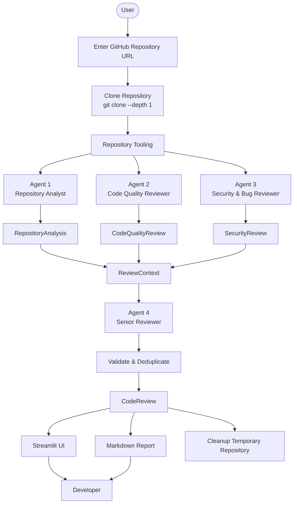

---

# 👨‍💻 Author

## Arpan Neupane

**Computer Engineering | AI/ML | Python | Multi-Agent AI**

GitHub:

**https://github.com/arpanneupane75**

---

# 📄 License

This project is currently intended for educational, research, and portfolio purposes.

If you plan to distribute the project publicly, add an appropriate open-source license such as MIT.

---

## ⭐ If You Find This Project Interesting

Feel free to explore the implementation, experiment with different repositories, and extend the agent architecture with additional specialized reviewers.
